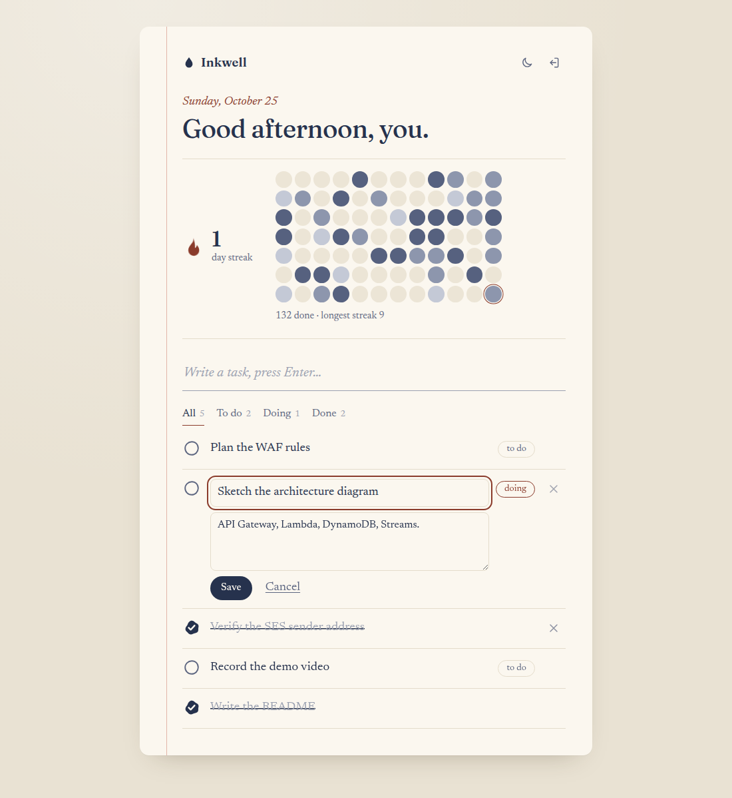
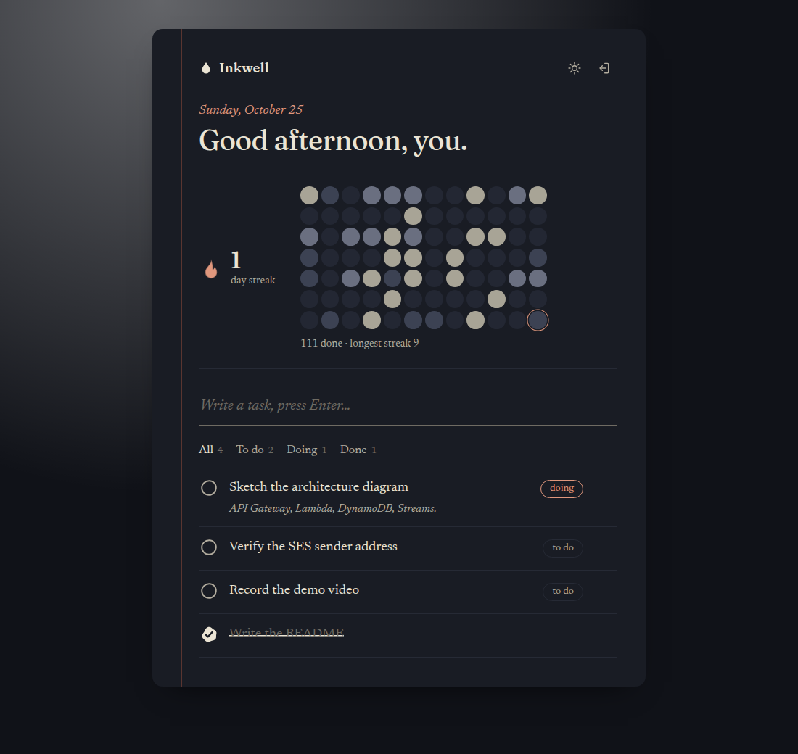
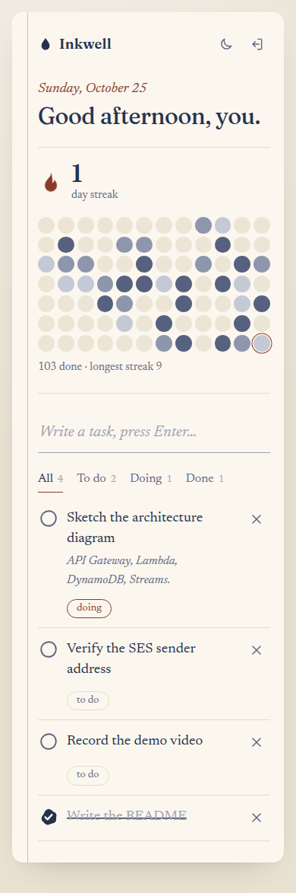
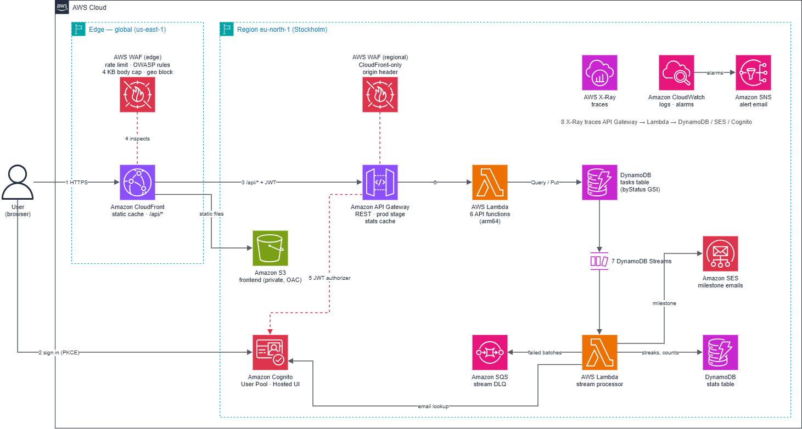

# Inkwell — Serverless To-Do API on AWS

> AWS Solutions Architect – Associate graduation project (Manara) — Project 3: Serverless REST API

A fully serverless, authenticated to-do journal. Users sign in with Amazon Cognito, then manage their
own tasks through API Gateway and AWS Lambda, with data in Amazon DynamoDB. A DynamoDB Streams consumer
keeps each user's streak and sends milestone emails through Amazon SES. The API is protected by AWS
WAF, accelerated by CloudFront and API Gateway caching, and traced end-to-end with AWS X-Ray.

**Live app:** https://dvbqb6alr9byb.cloudfront.net/

## Table of Contents

- [Solution Overview](#solution-overview)
- [Architecture Diagram](#architecture-diagram)
- [AWS Services](#aws-services)
- [API](#api)
- [Data Model](#data-model)
- [Key Design Decisions](#key-design-decisions)
- [Repository Structure](#repository-structure)
- [Customizing the Solution](#customizing-the-solution)
- [Cost](#cost)
- [License](#license)

# Solution Overview

Inkwell is a quiet notebook for things to do: write a task, cross it out, keep the streak. Each
completion becomes an ink dot on a 12-week calendar, and milestones (your first task, 10/50/100 done,
7- and 30-day streaks) arrive as a short congratulation email.

| Light | Dark | Phone |
|---|---|---|
|  |  |  |

# Architecture Diagram



1. The user loads the static frontend from **S3** through **CloudFront**. Fonts and icons are cached for a year; HTML, CSS and JS for a short TTL.
2. The user signs in with the **Cognito** Hosted UI (authorization code + PKCE) and receives a JWT.
3. The frontend calls the API through **CloudFront → API Gateway** with the JWT in the `Authorization` header.
4. **WAF** inspects the request: rate limiting, the AWS managed OWASP rule set, and a 4 KB body cap.
5. The **Cognito authorizer** validates the token. Invalid or missing tokens get a `401` before any Lambda runs.
6. **Lambda** runs the route's logic against the **DynamoDB** `tasks` table, scoped to the caller's user ID.
7. **DynamoDB Streams** delivers each task change to the stream processor, which updates the `stats` table and sends milestone emails through **SES**.
8. **X-Ray** traces API Gateway → Lambda → DynamoDB / SES / Cognito.

# AWS Services

| Service | Role |
|---|---|
| **Amazon API Gateway** | REST API, Cognito authorizer, throttling, per-user caching of `GET /stats` |
| **Amazon Cognito** | User Pool, Hosted UI, JWT issuance; email lookup for milestone notes |
| **AWS Lambda** | One function per route plus the stream processor on arm64 (Graviton); least-privilege role each |
| **Amazon DynamoDB** | `tasks` (on-demand, GSI by status, Streams) and `stats` tables |
| **Amazon SES** | Milestone congratulation emails |
| **AWS WAF** | Rate-based rule, managed OWASP rules, request body size cap |
| **Amazon CloudFront** | CDN for the frontend and the API (`/api/*`) |
| **Amazon S3** | Private bucket for the frontend, Origin Access Control |
| **AWS X-Ray** | Distributed tracing and service map |
| **Amazon CloudWatch** | Logs, metrics and alarms |

# API

All routes require a Cognito JWT. Requests may send `X-Client-Date: YYYY-MM-DD` so streaks follow the
user's local calendar.

| Method | Path | Description |
|---|---|---|
| `GET` | `/tasks` | List the user's tasks, newest first (optional `?status=todo\|doing\|done`) |
| `POST` | `/tasks` | Create a task: `{title, description?, status?}` |
| `GET` | `/tasks/{id}` | Get one task |
| `PUT` | `/tasks/{id}` | Update any of `title`, `description`, `status` |
| `DELETE` | `/tasks/{id}` | Delete a task |
| `GET` | `/stats` | Totals, longest streak, daily completions, milestones reached |

Limits: title 1–120 characters, description up to 1,000, 500 tasks per user, 4 KB request body.

# Data Model

**`tasks`** — on-demand, Streams (`NEW_AND_OLD_IMAGES`)

| Key | Attribute | Purpose |
|---|---|---|
| Partition key | `userId` | Isolates each user's data |
| Sort key | `taskId` | ULID, so the base table is already sorted by creation time |
| GSI `byStatus` | `userId` / `statusCreatedAt` | Lists a user's tasks by status, sorted by date |

Other attributes: `title`, `description`, `status`, `createdAt`, `updatedAt`, `completedAt`, `completedDay`.

**`stats`** — written only by the stream processor

| Item (`sk`) | Holds |
|---|---|
| `SUMMARY` | total completions, longest streak, milestones already emailed |
| `DAY#YYYY-MM-DD` | completions on that day |
| `DONE#<taskId>` | marker that makes each completion count exactly once |

Every request is a single `Query` or key lookup, never a `Scan`.

# Key Design Decisions

- **Serverless over EC2.** No servers to patch, scales to zero, pay per request — right for a spiky, low-traffic workload.
- **Cognito authorizer at API Gateway.** Unauthenticated traffic is rejected before Lambda runs. The user ID comes from the validated token, never the request body. Another user's task returns `404`, not `403`.
- **Streams with a real job.** Stats are derived asynchronously from task changes, in their own table so the stream can never trigger itself. Un-ticking a task removes the completion; deleting a finished task keeps it in your history.
- **Exactly-once under retries.** Completion counters and milestone emails are idempotent, so stream retries never double-count or double-send, and an email SES rejects never blocks the stream.
- **Caching that is safe.** CloudFront caches static assets; API Gateway caches only `GET /stats`, keyed by the caller's token. Task routes are never cached.
- **Small requests, tight WAF.** Strict field limits let WAF drop any body over 4 KB.
- **Least privilege.** Each Lambda has its own IAM role scoped to the tables and actions it uses.
- **Infrastructure as Code.** The stack is defined in Terraform: reproducible, reviewable, torn down with one command.

# Repository Structure

```
├── CHANGELOG.md
├── LICENSE
├── NOTICE
├── README.md
├── deployment/
│   ├── build-dist.sh            # packages the Lambda zips and the X-Ray layer
│   └── run-unit-tests.sh        # lint + every test suite
├── docs/
│   ├── inkwell-architecture.drawio  # diagram source (draw.io)
│   ├── inkwell-architecture.png     # architecture diagram
│   └── screenshots/
└── source/
    ├── shared/                  # inkwell package used by every Lambda
    ├── task-api/                # one handler per API route
    ├── stream-processor/        # DynamoDB Streams consumer
    ├── frontend/                # static HTML/CSS/vanilla JS client
    └── infrastructure/          # Terraform
```

Each component has its own README: see [source/README.md](source/README.md).

# Customizing the Solution

## Prerequisites

- Python 3.12 and [uv](https://docs.astral.sh/uv/)
- Node.js 20+ (frontend tests)
- Terraform ≥ 1.5; AWS credentials for deployment

## 1. Clone the repository

```bash
git clone <repository-url>
cd <repository-folder>
```

## 2. Unit test

```bash
cd deployment
./run-unit-tests.sh
```

Runs ruff, the Lambda tests (pytest against in-memory AWS via moto), the frontend tests, and the
Terraform checks (validate + an apply against mocked providers). None of them need AWS credentials.

## 3. Preview the frontend

Set `mock: true` in `source/frontend/js/config.js`, then:

```bash
python3 -m http.server -d source/frontend 8000
```

## 4. Build and deploy

```bash
./deployment/build-dist.sh
cd source/infrastructure
cp terraform.tfvars.example terraform.tfvars   # set sender_email and alert_email
terraform init
terraform apply
```

Terraform prints the app URL, the direct API URL (blocked from outside CloudFront) and the Cognito sign-in
URL. Then confirm the SES and SNS emails. Demo switches, checks and teardown are in
[source/infrastructure/README.md](source/infrastructure/README.md).

# Cost

A few dollars to build and demo, close to $0 when idle:

- **Free-tier eligible at this scale:** Lambda, DynamoDB on-demand, Cognito, CloudFront, S3, SES and X-Ray.
- **Billed hourly or monthly:** the WAF web ACL and its rules, and the API Gateway cache. Enable the cache only when needed.
- **Guardrail:** an AWS Budget alarm is set up before deploying.

# License

Licensed under the Apache License, Version 2.0. See [LICENSE](LICENSE) and [NOTICE](NOTICE).
